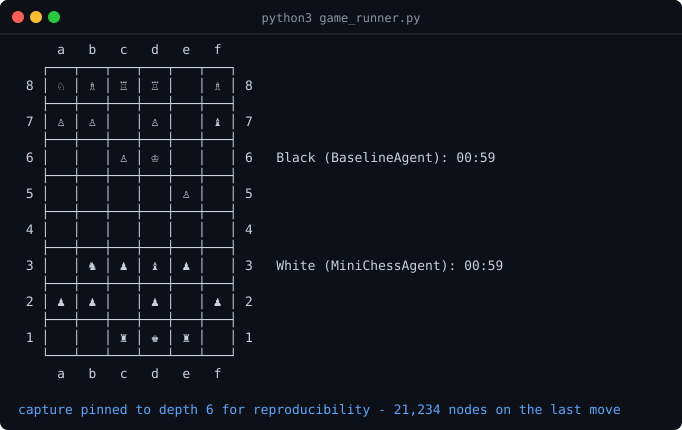

# 6×8 Minichess Agent

An adversarial search agent for a 6×8 chess variant. It reaches roughly **13 ply
in a 60-second game in pure Python**, and scores the maximum the rules allow
against every opponent it was tested against.

Single file, standard library only, Python 3.9+.

[](https://github.com/SreenityaThatikunta/minichess-agent/actions/workflows/tests.yml)
[](LICENSE)
[](https://www.python.org/downloads/)

<p align="center">
  
</p>

## Quick start

No dependencies and nothing to configure — the agent is standard library only.

```bash
git clone https://github.com/SreenityaThatikunta/minichess-agent.git
cd minichess-agent
python3 tournament_match.py --games 4        # the agent against its baseline
python3 -m unittest discover -s tests -t .   # 29 tests, about 11 seconds
```

`tournament_match.py --help` lists the rest: `--white` and `--black` take
`agent`, `baseline`, `random`, `random-delay` or any `module:ClassName`.

## Results

Scored under the tournament rules, four games a matchup, colours alternating:

| Test | Result |
| --- | --- |
| vs a random-move opponent | 600 points a game, 4–0, checkmate every game |
| vs a random opponent with think delay | 600 points a game, 4–0, checkmate every game |
| vs this agent's own earlier version | 600 points a game, 4–0, checkmate every game |
| Search depth on the clock | 13.35 ply |
| Node rate | ~290,000 positions/second |
| Time forfeits | zero, across every game played |

600 is the maximum the rules allow. Reproduce any row with
`python3 tournament_match.py --white agent --black random --games 4`.

### Two scoring systems, and which one these numbers are in

Worth knowing before you run anything, because the repository contains both.

`tournament_match.py` implements the **tournament rules**, which is what every
number here and in the write-up was measured under: a checkmate pays an absolute
600 overriding captured material, a loss pays 0 regardless of what was captured
first, and a draw pays the value of the pieces you captured.

`game_runner.py` is the **sample runner** the variant shipped with, and it scores
differently — both sides keep their capture points, a check is worth +2 and a
checkmate adds +300, with no override and no zeroing on a loss. It is unmodified
third-party code, kept so the agent can be dropped into the original harness, and
it will print totals like 818–282 for a game the tournament rules score 600–0.
Neither is wrong; they are different rule sets, and the agent is tuned for the
first.

## The interesting part

The tournament scoring is **not zero-sum**. A match pays 600 for checkmate, 0 for
a loss, and otherwise the value of the pieces *you* captured — your opponent's
captures never subtract from your score. Total capturable material is 530, less
than the 600 a mate pays.

So the priority order is: never lose, then mate, then capture. That drives every
design decision, and my first instinct about how to exploit it — trade very
freely, since even trades are pure profit — was measurably wrong. It scored 291
points a game against 515 for near-symmetric play, because bleeding material to
bank captures just gets you mated.

## How it works

```
get_best_move()
      │
      ├─ opening book (379 positions) ─────────────── immediate move, no search
      │
      └─ clock allocator: this move's slice of the 60s
               │
               ▼
         iterative deepening ── depth 1, 2, 3 … ── best move so far is always
               │                                   usable, so the clock can
               │                                   stop it at any point
               ▼
         negamax + alpha-beta + principal-variation search
               │
               ├─ transposition table (64-bit Zobrist)
               ├─ move ordering: TT move, captures by SEE, killers, history
               ├─ pruning: null-move, late-move reductions, check extensions
               │
               └─ quiescence search over captures ── static exchange evaluation
                           │
                           ▼
                     evaluation
                     ├─ tapered piece-square tables
                     ├─ rook file control and mobility
                     └─ king pawn shield
```

Underneath all of it is the agent's **own move generator** — a 48-square array
with precomputed attack tables and incremental make/unmake. That is **47× the
node rate** of driving the engine's own generator, and it is verified
move-for-move against it across 217,000 positions. The test suite re-checks that
parity on every run, because a divergence is a move the search believes in that
the referee would reject.

## Layout

| File | What it is |
| --- | --- |
| `minichess_agent.py` | The agent |
| `baseline_agent.py` | The earlier version, kept as a measurement baseline |
| `tournament_match.py` | Match runner and score card under the tournament rules |
| `tests/` | 29 tests: generator parity, perft, make/unmake, tactics, scoring |
| `tools/render_demo.py` | Regenerates the screenshot above |
| `ENGINEERING.md` | Full write-up: design, measurements, what failed |
| `board.py`, `config.py`, `game_runner.py` | The game engine and sample runner. Third party — see `NOTICE` |
| `p22cs201.py`, `p25cs0004.py` | Sample random-move opponents. Third party |

## Tests

```bash
python3 -m unittest discover -s tests -t .
```

29 tests, no dependencies, about 11 seconds. The suite covers move generator
parity against the engine across ~500 positions from random games, perft counts
from the opening position, make/unmake and Zobrist hash reversibility — where
both bugs found during development lived — the agent's contract with the match
runner, forced tactics, clock discipline, and the score card's override rules.
CI runs it on Python 3.9, 3.11 and 3.13, plus a full game end to end.

## Full write-up

**[ENGINEERING.md](ENGINEERING.md)** has the detail: the complete architecture,
every approach that was tried and measured, the four predictions the data
contradicted, two real bugs and how they were caught, the testing methodology,
and the agent's known limitations.

## Licence

MIT, see `LICENSE`. It covers the agent, the match runner, the tests and the
write-up; the game engine and sample opponents are third party and keep their
original terms, set out in `NOTICE`.
